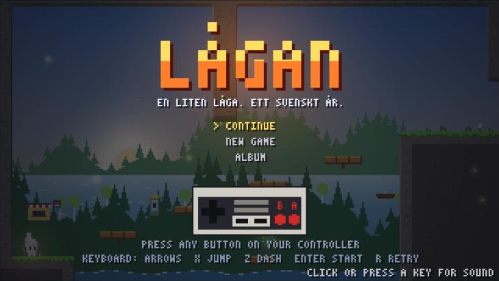
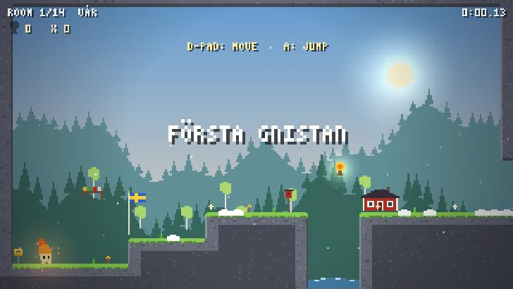
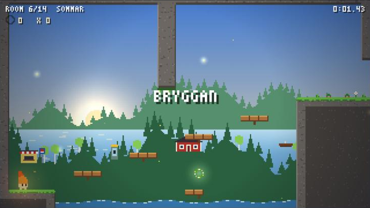
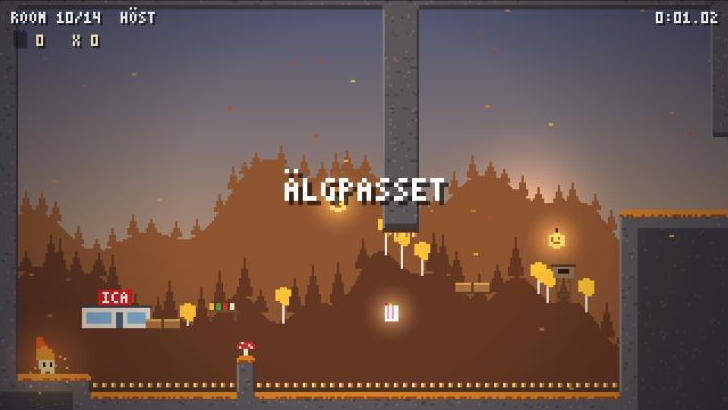
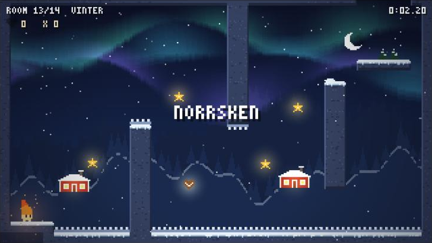
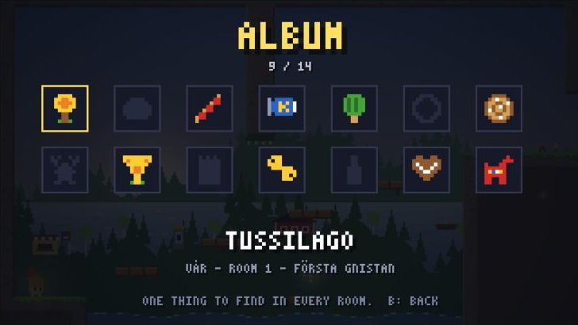

<h1 align="center">Lågan</h1>

<p align="center"><b>En liten låga. Ett svenskt år.</b><br>
A small flame carried home through a Swedish year: a precision platformer for a NES controller, played in the browser.</p>

<p align="center"></p>

Jump, wall jump and dash through fourteen rooms and four seasons, from the first coltsfoot of spring to the
northern lights. Every room is one screen, death costs a second, and every room hides one thing for the album.

## A year in fourteen rooms

| | |
|---|---|
|  **Vår.** Melting snow, coltsfoot by the road, the Valborg bonfire. |  **Sommar.** A sun that only dips, the lake, the jetty, the kiosk, the maypole. |
|  **Höst.** Crayfish lanterns, chanterelles, the elk sign and the hunting tower. |  **Vinter.** Blue dusk, advent stars, the straw goat, and the aurora. |

Look into the distance now and then. There is an ICA, a row of mailboxes at the turn-off, a Volvo with a roof box,
and every half minute or so the yellow Posten van comes by.

## The album

<p align="center"></p>

One thing to find in each room, and to carry out of it alive: a tussilago, wild strawberries on a straw, a tube of
Kalles kaviar, a Piggelin, a kanelbulle, a bag of lördagsgodis, a Dalahäst. The album keeps what you have found
between runs.

## How to play

| | Controller | Keyboard |
|---|---|---|
| Move and aim | D-pad | Arrow keys |
| Jump, and wall jump | A | X |
| Dash, in eight directions | B | Z |
| Pause | Start | Enter |
| Retry the room | Select | R |

- You have one dash. Landing gives it back, and so does a lantern. The flame is orange with a dash ready and blue without.
- A dash burns through hay, leaves and ice.
- Jetty planks and thin ice give way a moment after you land on them.
- A fly agaric throws you into the air.

Any USB NES-style controller works. The first time one is plugged in the game asks for A, B, Start and Select once,
because these pads number their buttons differently.

## Run it

There is nothing to install and nothing to build.

```sh
git clone https://github.com/elitan/lagan
cd lagan
python3 -m http.server 8777     # then open http://localhost:8777
```

## How it is made

Plain JavaScript on one canvas, 320 x 180 pixels. No dependencies and no image or sound files: every sprite,
backdrop and note of music is made in code.

| | |
|---|---|
| `src/sim.js` | The rules: one room, one player, sixty steps a second |
| `src/levels.js` | The rooms |
| `src/render.js` | The seasons and everything drawn in them |
| `src/audio.js` | Sound effects, and a polska for each season |
| `src/main.js` | The loop, the screens, saving |
| `tools/solve.js` | Proves every room can be finished, with and without its album item |

`node tools/solve.js` plays every room with the real game rules and fails if one cannot be finished. Run it after
changing a room or the physics. `?room=7` in the address opens a room directly.

---

A hobby project, not affiliated with ICA, PostNord, Volvo, Kalles, GB Glace or anyone else whose name appears in
it. They are here because they are part of what a Swedish year looks like.
